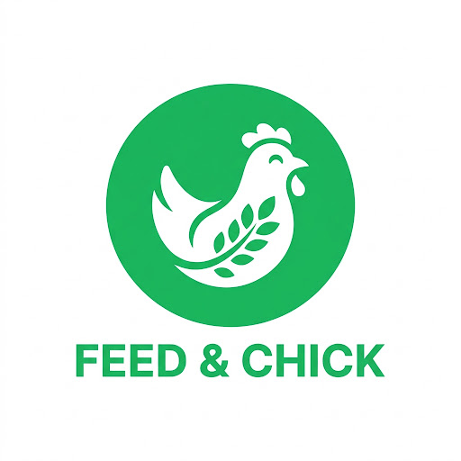

<div align="center">
  

  # 🐔 CluckFeed (Feed & Chick)
  **Sistem Cerdas Manajemen & Formulasi Pakan Ternak Ayam Berbasis Kebutuhan Nutrisi dan AI**

  [](https://react.dev/)
  [](https://vitejs.dev/)
  [](https://www.typescriptlang.org/)
  [](https://tailwindcss.com/)
</div>

---

## 📌 Tentang Proyek

**CluckFeed** adalah platform kalkulasi dan formulasi pakan unggas (broiler & layer) yang dirancang untuk membantu peternak meracik pakan secara presisi, hemat biaya (*least-cost formulation*), dan sesuai dengan standar nutrisi (SNI Kementan RI). Aplikasi ini dilengkapi dengan asisten AI nutrisi pakan serta integrasi kontrol mesin dispensing pakan otomatis.

### 🌟 Fitur Utama

- **Kalkulator & Formulasi Ransum Otomatis**: Menghitung kombinasi bahan baku lokal (jagung, dedak, bungkil kedelai, MBM, premix) dengan target protein kasar (PK), energi metabolis (EM), kalsium, dan fosfor yang seimbang.
- **Target Kebutuhan Nutrisi Harian**: Rekomendasi otomatis berdasarkan jenis ayam, fase pertumbuhan (starter, grower, finisher), umur ayam, dan jumlah populasi.
- **Katalog & Input Harga Bahan Pakan**: Simulasi biaya riil per kilogram ransum jadi dan proyeksi penghematan operasional pakan.
- **Asisten AI Nutrisi Pakan**: Konsultasi interaktif terkait gejala malnutrisi, substitusi bahan pakan alternatif, dan rasio ideal.
- **Monitoring & Kalibrasi Mesin Dispenser**: Integrasi kontrol takaran dan kalibrasi motor servo/auger dispenser pakan.
- **Riwayat & Preset Formula**: Simpan formula pakan terbaik untuk digunakan kembali sewaktu-waktu.

---

## 🚀 Panduan Menjalankan Program Secara Lokal

### 📋 Prasyarat Sistem
Pastikan perangkat Anda sudah terpasang:
- **[Node.js](https://nodejs.org/)** (v18.x atau lebih baru disarankan, misal Node 20 LTS / 22 / 24)
- **npm** (biasanya terpasang otomatis bersama Node.js)
- **Git**

---

### 🛠️ Langkah-Langkah Instalasi & Menjalankan

#### 1. Masuk ke Direktori Proyek
Buka terminal (Command Prompt / PowerShell / Bash) lalu arahkan ke folder proyek:
```bash
cd c:\Naff\CluckFeed
```

#### 2. Pasang Dependensi Proyek
Jalankan perintah berikut untuk mengunduh seluruh dependensi yang diperlukan:
```bash
npm install
```
> **Catatan:** Jika muncul peringatan atau bentrok dependensi paket, Anda dapat menggunakan:
> ```bash
> npm install --legacy-peer-deps
> ```

#### 3. Konfigurasi File Environment (Opsional)
Salin berkas contoh `.env.example` menjadi `.env.local`:
- **Windows (PowerShell):**
  ```powershell
  Copy-Item .env.example .env.local
  ```
- **Linux / macOS / Git Bash:**
  ```bash
  cp .env.example .env.local
  ```
Buka `.env.local` dan masukkan `GEMINI_API_KEY` jika Anda ingin mengaktifkan integrasi fitur AI Gemini secara langsung.

#### 4. Jalankan Development Server
Mulai server lokal Vite dengan perintah:
```bash
npm run dev
```

Output di terminal akan menampilkan tautan server lokal:
```text
  VITE v8.x.x  ready in xxx ms

  ➜  Local:   http://localhost:3000/
  ➜  Network: http://xxx.xxx.xxx.xxx:3000/
```

#### 5. Buka di Browser
Buka browser favorit Anda (Chrome, Edge, Firefox) dan akses:
👉 **[http://localhost:3000](http://localhost:3000)**

*(Untuk menghentikan server yang sedang berjalan, tekan tombol `Ctrl + C` pada terminal).*

---

## 📦 Perintah Tambahan (Scripts)

| Perintah | Deskripsi |
| :--- | :--- |
| `npm run dev` | Menjalankan server pengembangan lokal (port 3000) |
| `npm run build` | Melakukan kompilasi bundle produksi ke folder `dist` |
| `npm run preview` | Menjalankan preview lokal dari hasil build `dist` |
| `npm run lint` | Menjalankan pengecekan tipe data TypeScript |

---

## 📁 Struktur Direktori Singkat

```text
CluckFeed/
├── public/
│   ├── logo.png             # Logo aplikasi Feed & Chick
│   └── assets/              # Aset statis & gambar pendukung
├── src/
│   ├── components/          # Komponen UI bersama (Header, BottomNav, dll)
│   ├── data/                # Mock data bahan pakan, standar SNI, riwayat
│   ├── screens/             # Layar aplikasi (Beranda, Formulasi, AI, Dispenser, Profil)
│   ├── utils/               # Logika pemecah formulasi nutrisi (solver)
│   ├── types/               # Definisi tipe TypeScript
│   ├── App.tsx              # Router & layout utama
│   └── main.tsx             # Titik masuk React
├── package.json             # Konfigurasi dependensi dan skrip
├── vite.config.ts           # Konfigurasi Vite & Tailwind CSS
└── README.md                # Dokumentasi proyek
```

---

## 💡 Troubleshooting (Kendala Umum)

1. **`'vite' is not recognized as an internal or external command`**:
   - Penyebab: Folder `node_modules` belum ada atau instalasi belum selesai.
   - Solusi: Jalankan `npm install`.

2. **`npm error ENOSPC: no space left on device`**:
   - Penyebab: Ruang penyimpanan pada drive (Drive C:) hampir penuh.
   - Solusi: Kosongkan minimal 2–3 GB ruang penyimpanan pada disk Anda, lalu jalankan kembali `npm install`.
